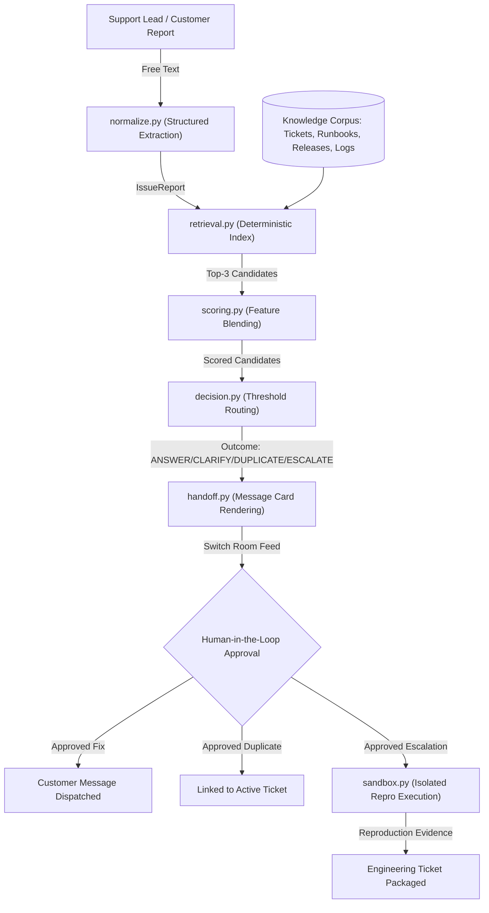

# RelayDesk 🛎️

> **Evidence-Gated Customer Support Triage and Engineering Escalation**  
> Built for the **Flip the Switch** Hackathon (Nov 4–7, 2026) by **WeMakeDevs** + **Switch AI**  
> **Track:** Best Business Workflow · **Team:** Solo (Ketan Kumar Chokkara — AI Engineer & Data Scientist)

<p align="center">
  
</p>

---

## The Problem

Frontline support teams face a painful trade-off:
1. **Over-escalation:** Support agents escalate routine questions or already-known bugs to engineering, burying developers in duplicate tickets and false alarms.
2. **Under-escalation / Hallucination:** Generic LLM bots try to answer every question, guessing root causes, fabricating diagnostic steps, or sending incorrect advice to frustrated customers.

## The Solution

**RelayDesk** is an **evidence-gated support-to-engineering coordination system**. It coordinates human support leads and Switch agents in a shared room where every triage decision is strictly **grounded in verified evidence**:

- **`ANSWER`** — Grounded solution citing an exact verified runbook section (confidence $\ge 0.65$).
- **`CLARIFY`** — Targeted clarifying question when reproduction steps, environment, or error signatures are missing.
- **`DUPLICATE`** — Links to an active open incident with symptom, component, and timing evidence (confidence $\ge 0.75$).
- **`ESCALATE`** — Packages novel code defects with sandboxed test execution reproduction evidence for engineering review.

**Zero Unsupported Assertions:** Agents never suggest an outcome without presenting a ranked **`[EVIDENCE]` Card** and obtaining **Human Sign-Off** before customer-facing action is taken.

> *"RelayDesk isn’t another AI chatbot wrapper. It is an evidence-gated operational workflow that prevents AI from making support and engineering decisions without verifiable proof."*

---

## How Switch is Used (30% Rubric Priority)

Switch is the essential collaboration and audit backbone of RelayDesk. Without Switch, the multi-agent orchestration, peer-to-peer handoffs, human sign-off, and audit trail completely collapse.

### 1. Which Agents Are Connected

| Agent | Provider | Addressing Policy | Role & Responsibilities |
|---|---|---|---|
| **`@relaydesk-triager`** | Antigravity | `anyone` (Public frontline) | First-responder triage bot. Ingests raw incident text, extracts error signatures & component metadata via regex normalization, queries the deterministic retrieval index, computes weighted 4-feature evidence scores, and renders formatted `[EVIDENCE]` and `[DECISION]` cards. Always requires human sign-off before customer-facing action. |
| **`@relaydesk-investigator`** | Antigravity | `ownerAndAgents` (Restricted handoff) | Deep technical investigation bot. Wakes up only when tagged by human leads or delegated by `@relaydesk-triager` upon `ESCALATE` decisions. Spawns disposable temp-copy sandboxes, runs allow-listed test suites (`pytest`), captures assertion failures, and posts verified `[REPRODUCTION RESULT]` cards for engineering review. |

### 2. How the Channel / Room is Set Up

RelayDesk operates inside a shared room (`#support-triage`) bridged to Discord via Switch:

1. **Discord Bridge Setup:**
   - In Discord Developer Portal, create an Application and Bot.
   - Under **Bot > Privileged Gateway Intents**, enable **Server Members Intent** and **Message Content Intent**.
   - Invite the bot to your Discord server with `Administrator` / `Manage Channels` permissions.
   - In **Switch Console > Settings > Bridges > Discord**, paste the Bot Token and connect the bridge.

2. **Room Configuration:**
   - In Switch Console, create a room named `#support-triage` (or import [`config/room-config.yaml`](config/room-config.yaml)).
   - Add `@relaydesk-triager` and `@relaydesk-investigator` to the room, pointing their working directories to the repository root.
   - Configure `@relaydesk-triager` with `addressing: anyone` and `@relaydesk-investigator` with `addressing: ownerAndAgents` (with command execution permissions enabled for sandbox reproduction).

3. **Threaded Audit Trail & Human Approval:**
   - Every incident report triggers a distinct investigation thread.
   - Triage proposals pause automatically with a mandatory approval step (`Awaiting human operator approval before dispatching customer replies or closing this ticket`).
   - The human support lead retains absolute authority to approve, override, or request deeper sandbox reproduction.

---

## Architecture



---

## Quickstart & Reproducibility (Under 2 Minutes)

### 1. Environment Requirements
- Python 3.11+
- Git

### 2. Setup
```bash
# Clone the repository
git clone https://github.com/CodeUltr0n/RelayDesk.git
cd RelayDesk

# Create and activate virtual environment
python3 -m venv .venv
source .venv/bin/activate

# Install dependencies (zero bloat — pure stdlib + PyYAML)
pip install -e ".[dev]"
```

### 3. Run Test Suite (27 Tests)
```bash
make test
```
*Expected: 27 passed in ~0.20s (including unit, integration, decision threshold, and sandbox shell injection tests).*

### 4. Run Benchmark Evaluation
```bash
make eval-relaydesk   # Evaluate on dev split
make eval-heldout     # Evaluate on strict held-out split
```

### 5. Run Live in Discord via Switch
Once the Switch Discord bridge is active, post an incident report in `#support-triage`:

**Scenario 1 — Automated Duplicate Triage (`DUPLICATE`):**
```
@relaydesk-triager Customer reports payment total mismatch (HTTP 500) on checkout-service v2.14.0 since this morning's release.
```
> `@relaydesk-triager` parses the report, queries the corpus, scores candidates, outputs the `[EVIDENCE]` Card highlighting `INC-1042` (confidence 0.86), posts `[DECISION] DUPLICATE`, and pauses for human operator approval.

**Scenario 2 — Escalation & Sandboxed Reproduction Handoff (`ESCALATE`):**
```
@relaydesk-triager Customer reports discount calculation failure in price_calculator on 10% discount orders. checkout-service v2.14.0. No matching past incident. Please escalate to @relaydesk-investigator to run reproduction tests in the sandbox.
```
> `@relaydesk-triager` flags the novel defect, outputs `[DECISION] ESCALATE`, and delegates to `@relaydesk-investigator`.  
> `@relaydesk-investigator` spins up a disposable sandbox, runs `pytest`, captures the `ROUND_DOWN` vs `ROUND_HALF_UP` 1-cent mismatch assertion failure, and posts a verified `[REPRODUCTION RESULT]` card with root cause analysis.

**Scenario 3 — Grounded Runbook Resolution (`ANSWER`):**
```
@relaydesk-triager Customer reports stale search results in search autocomplete on search-service v3.2.1. Products that were deleted yesterday still appear in search results.
```
> `@relaydesk-triager` grounds a resolution directly from Runbook `RB-501` (`search_troubleshooting`), providing verified alias swap commands and cache invalidation steps, pausing for human sign-off before customer dispatch.

**Scenario 4 — Smart Clarification (`CLARIFY`):**
```
@relaydesk-triager Customer says the CSV export button in Reports does nothing when clicked. No error message shown. No app version or browser provided.
```
> Rather than hallucinating a speculative fix, `@relaydesk-triager` identifies missing technical context and asks a single targeted diagnostic question (app version, browser, developer console error).

---

## Hardened Sandbox Security & Isolation

When `@relaydesk-investigator` executes verification tests, safety is enforced across five distinct layers:
1. **Filesystem Isolation:** Every test suite executes inside an ephemeral temporary directory (`tempfile.mkdtemp`); the host repository is never modified.
2. **Shell Injection Defense:** Commands are parsed into tokenized argv arrays using `shlex.split`, blocking all shell metacharacters (`;`, `&`, `|`, `>`, `<`, `$`, `` ` ``), and executed strictly with `shell=False`.
3. **Command Allow-List:** Only vetted verification binaries (`pytest`, `python`, `python3`, `make`) are authorized. Arbitrary binary execution is blocked with `SandboxError`.
4. **Process Timeouts:** Enforces execution deadlines (`timeout_s: 120`), immediately killing runaway loops or hangs.
5. **Network Blackholing:** Proxy blackholing (`http_proxy=http://127.0.0.1:0`, `https_proxy=http://127.0.0.1:0`, `no_proxy=*`) prevents outbound network egress.
6. **Log Echo Limits:** Untrusted output tails are strictly capped (`max_log_echo_lines: 20`) to eliminate context window exhaustion and prompt injection risks.

---

## Benchmark Results

> **Evaluation Methodology:** Evaluated over an 8-case synthetic verification benchmark suite (4 dev, 4 held-out) designed to measure decision accuracy, evidence retrieval recall, and dynamic citation verification without dataset leakage.

| Metric | Null Baseline (Always Escalate) | RelayDesk (Dev Split) | RelayDesk (Held-out Split) |
|---|---|---|---|
| **`correct_next_action`** | 25.0% | **100.0%** | **100.0%** |
| **`escalation_precision`** | 25.0% | **100.0%** | **100.0%** |
| **`escalation_recall`** | 100.0% | **100.0%** | **100.0%** |
| **`top3_evidence_recall`** | 50.0% | **100.0%** | **100.0%** |
| **`unsupported_assertion_count`** | 0 | **0** | **0** |
| **`median_latency_ms`** | 0.0 ms | **0.5 ms** | **0.4 ms** |

### Benchmark Takeaway
- **100% Escalation Precision:** Zero false alarms sent to engineering.
- **100% Escalation Recall:** Every genuine technical defect was captured.
- **0 Unsupported Assertions:** All cited evidence IDs are dynamically validated against the knowledge corpus.
- **Sub-Millisecond Latency:** Decisions computed in under 0.5 ms.

---

## Repository Structure

```
relaydesk/
├── config/
│   ├── policy.yaml              # Tunable scoring weights and decision thresholds
│   ├── message_templates.yaml   # UI copy for Evidence, Decision, and Case cards
│   └── room-config.yaml         # Official Switch room configuration
├── src/relaydesk/
│   ├── schemas.py               # Pydantic-free core data contracts
│   ├── normalize.py             # Regex-based extraction of error signatures & components
│   ├── retrieval.py             # Deterministic token containment & metadata index
│   ├── scoring.py               # 4-feature weighted evidence scoring engine
│   ├── decision.py              # Priority decision router
│   ├── handoff.py               # Room card formatting and templating
│   ├── sandbox.py               # Disposable isolated test execution runner
│   └── mcp_server.py            # Stdio JSON-RPC Model Context Protocol server
├── fixtures/
│   ├── tickets/                 # Active (INC-1042) and resolved (INC-1038) tickets
│   ├── runbooks/                # Troubleshooting runbooks with grounded answers
│   ├── releases/                # Deployment changelogs and notes
│   ├── logs/                    # Representative failure log samples
│   ├── cases/                   # Labelled dev and heldout evaluation cases
│   └── buggy_service/           # Deliberately broken service for sandbox reproduction
├── tests/
│   ├── test_schemas.py          # Data contract tests (5 tests)
│   ├── test_scoring.py          # Weight validation and score bounds (4 tests)
│   ├── test_decision.py         # Routing thresholds & novel defect escalation (7 tests)
│   ├── test_sandbox.py          # Disposable container & shell injection defense (4 tests)
│   ├── test_mcp.py              # MCP tool protocol verification (3 tests)
│   └── test_end_to_end.py       # Full lifecycle integration tests (4 tests)
├── docs/
│   ├── architecture.md          # In-depth architectural design
│   ├── evaluation.md            # Detailed benchmark breakdown
│   ├── safety.md                # Security, isolation, and untrusted data model
│   ├── demo-script.md           # 3-minute judged screencast walkthrough
│   └── blog-post.md             # In-depth technical writeup for hackathon submission
├── scripts/
│   └── run_eval.py              # Reproducible benchmark runner
├── Makefile                     # Shortcut targets (test, eval, eval-relaydesk)
└── pyproject.toml               # Minimal packaging configuration
```

---

## Documentation & References

- [Architecture Design](docs/architecture.md)
- [Benchmark Evaluation Report](docs/evaluation.md)
- [Safety & Isolation Model](docs/safety.md)
- [3-Minute Demo Video Script](docs/demo-script.md)
- [Technical Blog Post](docs/blog-post.md)
- [Switch Integration Notes](notes/integration-notes.md)
- [Bridge Configuration Guide](notes/bridges.md)
- [Model Evaluation Smoke Tests](notes/model_smoke.md)

---

## License

MIT License. Designed and submitted for the Flip the Switch Hackathon 2026.
