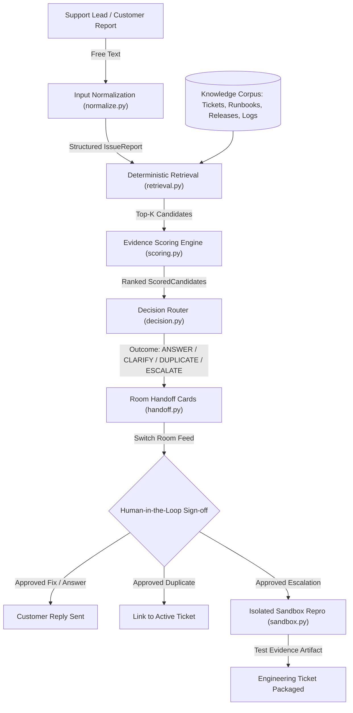

# RelayDesk — System Architecture

> Evidence-gated customer support triage and engineering escalation via Switch.

## Overview

RelayDesk sits between frontline customer support channels (Discord / Mattermost) and engineering bug trackers. Instead of letting raw LLMs hallucinate diagnostic causes or flood engineering with unverified escalations, RelayDesk enforces **evidence-gated decision routing**.

## Core Pipeline Stages

### 1. Ingestion & Normalization (`src/relaydesk/normalize.py`)
- Ingests raw, unstructured messages posted by support leads or customers.
- Extracts key technical metadata via deterministic regex extractors:
  - `component`: Target service (e.g., `checkout-service`, `search-service`).
  - `version`: Software release version (e.g., `v2.14.0`).
  - `error_signature`: Specific failure signature (quoted error strings, exception classes, HTTP status codes).
  - `first_seen`: Timestamp or observation window.
- Identifies missing fields (`missing_fields()`) to detect underspecified reports.

### 2. Deterministic Retrieval (`src/relaydesk/retrieval.py`)
- Indexes known artifacts from `fixtures/`:
  - `tickets/`: Active and resolved issue tickets.
  - `runbooks/`: Operational troubleshooting guides with executable resolutions.
  - `releases/`: Release deployment notes and changelogs.
  - `logs/`: Representative service error logs.
- Shortlists top candidates using token containment, component matching, and version matching. Completely deterministic with stable tie-breaking.

### 3. Evidence Scoring Engine (`src/relaydesk/scoring.py`)
Blends four distinct operational features defined in `config/policy.yaml`:

$$\text{Score} = w_1 \cdot F_{\text{error}} + w_2 \cdot F_{\text{component}} + w_3 \cdot F_{\text{timing}} + w_4 \cdot F_{\text{repro}}$$

| Feature | Weight | Definition |
|---|---|---|
| `error_symptom_match` | **35%** | Token containment and exact phrase match against error signature and symptoms |
| `component_version_match` | **25%** | Service name identity (60%) and software version alignment (40%) |
| `release_timing_match` | **20%** | Proximity between issue observation and deployment change window |
| `reproduction_evidence` | **20%** | Grounded runbook resolution or attached test repro artifacts |

*Scores rank candidates; they are not calibrated probabilities.*

### 4. Decision Router (`src/relaydesk/decision.py`)
Applies deterministic threshold gates in priority order:
1. **`DUPLICATE`**: Best candidate is an active/open ticket with $\text{score} \ge \text{duplicate\_min}$ ($0.75$).
2. **`ANSWER`**: Grounded runbook or resolution exists with $\text{score} \ge \text{answer\_min}$ ($0.65$).
3. **`CLARIFY`**: Score $\ge \text{clarify\_floor}$ ($0.45$) or report lacks error signature and misses critical reproduction fields.
4. **`ESCALATE`**: Novel failure with low confidence match; packages evidence for engineering investigation.

### 5. Room Handoff Cards (`src/relaydesk/handoff.py`)
Renders formatted audit trail cards into the Switch room:
- **`[EVIDENCE]` Card**: Top-3 shortlisted candidates with scores and rationale.
- **`[DECISION]` Card**: Proposed action, confidence, and drafted action (with human sign-off flag).
- **`[CASE]` Record**: Final immutable audit trail after human approval.

### 6. Isolated Sandbox Verification (`src/relaydesk/sandbox.py`)
For technical escalations requiring patch or reproduction verification:
- Clones target service to a disposable temporary directory.
- Enforces strict execution timeouts and best-effort network blocking.
- Restricts commands strictly to allow-listed binaries (`pytest`, `python3`, `make`).
- Truncates logs to avoid log flooding and prompt injection risks.

