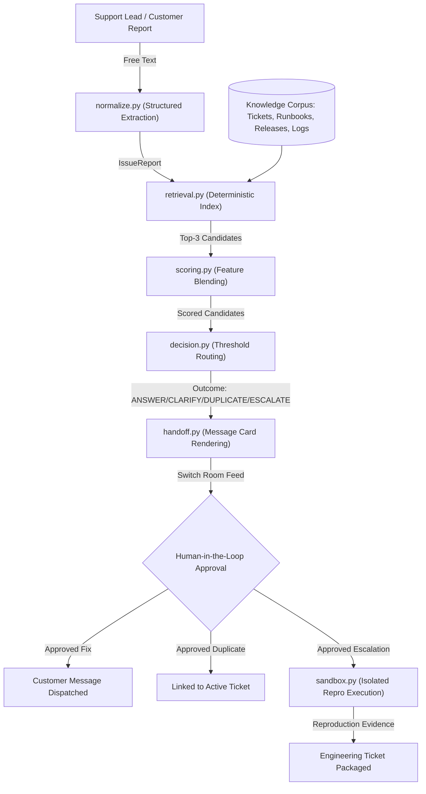

# Building RelayDesk: Evidence-Gated Multi-Agent Support Triage on Switch AI

*By Ketan Kumar Chokkara — AI Engineer & Data Scientist from India ([@CodeUltr0n](https://github.com/CodeUltr0n)) — Built for the Flip the Switch Hackathon (Nov 4–7, 2026)*

> 📺 **Watch the Demo Video on YouTube:** [https://youtu.be/Gi6qcB_jUVQ](https://youtu.be/Gi6qcB_jUVQ)

---

## 1. The Frontline Support Dilemma

Every software engineering organization faces a compounding crisis at the intersection of customer support and core engineering:

1. **Over-escalation & Alert Fatigue:** Support teams, overwhelmed by incoming tickets and lacking engineering context, reflexively escalate routine issues, transient glitches, or already-reported bugs to on-call engineers. Developers spend up to 30% of their sprints sifting through duplicate tickets.
2. **Under-escalation & Hallucinatory Support:** Organizations that deploy off-the-shelf generative AI chatbots often discover an even worse problem: ungrounded LLMs invent plausible-sounding troubleshooting steps, promise features that don't exist, or fail to recognize severe novel regressions that urgently require engineering intervention.

When building **RelayDesk** for the **Flip the Switch Hackathon**, our guiding principle was simple:

> **Never let an AI make a customer-facing or engineering decision without citing verified, structured evidence, and never take action without a human in the loop.**

Here is the story of how we built **RelayDesk** — an evidence-gated customer support triage and engineering escalation system powered by **Switch AI**, **Antigravity**, and **Discord**.

---

## 2. System Architecture: The Four Outcome Tracks

At the core of RelayDesk is a deterministic, evidence-gated pipeline that classifies every incoming customer report into one of exactly four outcomes:



### The 4 Decisions:
1. **`ANSWER` (Confidence $\ge 0.65$):** The issue is a known operational question with a verified resolution in a published troubleshooting runbook. The system cites the exact runbook section.
2. **`CLARIFY` (Ambiguous / Missing Signals):** Key diagnostics (component name, reproduction steps, version, or exact error text) are missing. The system asks a single targeted clarifying question rather than guessing.
3. **`DUPLICATE` (Confidence $\ge 0.75$):** The issue matches an active, open incident ticket (`INC-xxxx`) based on component, version, and error signature. Links to the existing incident to prevent duplicate triage.
4. **`ESCALATE` (Novel Defect):** The issue represents a genuine novel regression or unhandled error not covered by existing tickets or runbooks. Hands off to the investigation agent for sandboxed test reproduction.

---

## 3. Why Switch AI is Essential

RelayDesk is not a standalone Python script or a solitary bot; it is a collaborative multi-agent workflow designed for human teams. **Switch AI** provides the crucial infrastructure that makes this work:

### Multi-Agent Specialization
Rather than asking one monolithic LLM to do everything, RelayDesk connects two specialized agents in a shared room bridged to Discord:

- **`@relaydesk-triager` (Frontline Triage):** Configured with public addressing (`anyone`). Listens to customer and support lead messages in `#support-triage`, runs regex normalization, queries the deterministic retrieval index, scores evidence, and formats structured `[EVIDENCE]` and `[DECISION]` cards.
- **`@relaydesk-investigator` (Deep Investigation):** Configured with restricted addressing (`ownerAndAgents`). Wakes up only when tagged by human operators or delegated by `@relaydesk-triager`. Its sole job is to spin up an isolated sandbox, execute reproduction test suites, and report verified stack traces.

### Human-in-the-Loop Safety by Design
Every triage recommendation posted to the Switch room ends with:
```
Next: human approval required before anything is sent or merged.
```
No email is sent, no customer reply is dispatched, and no Jira ticket is filed until a human support lead gives the green light. Switch turns Discord into a mission control room where humans supervise AI agents in real time.

---

## 4. Under the Hood: Deterministic Scoring & Sandboxed Reproduction

### 1. Weighted Evidence Scoring Engine
Instead of asking an LLM "Does this ticket look like a duplicate?", RelayDesk computes an explainable 4-feature weighted score ($S \in [0.0, 1.0]$):

$$S = 0.35 \cdot M_{\text{error}} + 0.25 \cdot M_{\text{comp\_ver}} + 0.20 \cdot M_{\text{timing}} + 0.20 \cdot E_{\text{repro}}$$

- **Error Symptom Match ($M_{\text{error}}$):** Token containment between the normalized error signature and document tokens.
- **Component & Version Match ($M_{\text{comp\_ver}}$):** Strict metadata alignment with fallback to document body scanning.
- **Release Timing Match ($M_{\text{timing}}$):** Proximity between the incident observation and service deployment dates.
- **Reproduction Evidence ($E_{\text{repro}}$):** Quality of verified reproduction data (differentiating active open tickets from closed historical ones).

### 2. Disposable Sandbox Execution
When a novel defect is escalated, `@relaydesk-investigator` never runs tests in production or inside the main codebase. Instead, `relaydesk/sandbox.py`:
- Copies the suspect service into a **disposable temporary directory** (`tempfile.mkdtemp()`).
- Restricts commands strictly to allow-listed binaries (`pytest`, `python`, `python3`, `make`) parsed via `shlex.split`, running with `shell=False` to eliminate shell injection vulnerabilities.
- Enforces strict execution timeouts (`timeout_s: 120`) and proxy blackholing for network isolation.
- Caches and truncates test output tails (`max_log_echo_lines: 20`) to prevent log flooding and prompt injection.

---

## 5. Live Discord Walkthrough

> 📺 **Watch the live multi-agent execution in action:** [https://youtu.be/Gi6qcB_jUVQ](https://youtu.be/Gi6qcB_jUVQ)

Here is what the workflow looks like in practice inside our bridged Discord channel:

### Scenario 1: Automated Duplicate Triage
**Human:**
> `@relaydesk-triager Customer reports payment total mismatch (HTTP 500) on checkout-service v2.14.0 since this morning's release.`

**`@relaydesk-triager`:**
```markdown
Parsed report:
Component: checkout-service
Version: v2.14.0
Error signature: payment total mismatch (HTTP 500)
Observation timing: Since this morning (following this week's release)

[EVIDENCE] Candidate shortlist for this report:
Checkout HTTP 500 — payment total mismatch after v2.14.0 rollout [ticket] score=0.86 id=INC-1042
why: Score 0.86 for [INC-1042] (ticket): driven by error_symptom_match=1.00, component_version_match=1.00.

[DECISION] DUPLICATE (confidence 0.86)
Why: Top candidate [INC-1042] is an active ticket with score 0.86 >= duplicate threshold 0.75.
Evidence: INC-1042
Next: human approval required before anything is sent or merged.
```

### Scenario 2: Novel Bug Escalation & Sandboxed Reproduction
**Human:**
> `@relaydesk-triager Customer reports discount calculation failure in price_calculator on 10% discount orders. checkout-service v2.14.0. No matching past incident. Please escalate to @relaydesk-investigator to run reproduction tests in the sandbox.`

**`@relaydesk-triager`:**
> Evaluates candidates (top ticket score 0.70 < threshold 0.75). Issues `[DECISION] ESCALATE` and tags `@relaydesk-investigator`.

**`@relaydesk-investigator`:**
```markdown
[REPRODUCTION RESULT] Bug Confirmed

Component: checkout-service (v2.14.0) — price_calculator.py
Reproduction: Reproduced in isolated sandbox (disposable copy, network-isolated, allow-listed pytest).
Root Cause: Discount quantizing uses ROUND_DOWN instead of ROUND_HALF_UP, causing a 1-cent calculation error on 10% discount orders (134.98 vs expected 134.97).

Test failure log tail:
>       assert result == Decimal("134.97"), f"Got {result}, expected 134.97"
E       AssertionError: Got 134.98, expected 134.97

Recommendation: Create an engineering ticket for checkout-service to switch decimal rounding to ROUND_HALF_UP in price_calculator.py. Awaiting human operator approval.
```

### Scenario 3: Grounded Runbook Resolution (ANSWER)
**Human:**
> `@relaydesk-triager Customer reports stale search results in search autocomplete on search-service v3.2.1. Products that were deleted yesterday still appear in search results.`

**`@relaydesk-triager`:**
> Matches runbook `search_troubleshooting` (RB-501) and resolved ticket `INC-1038`. Outputs `[DECISION] ANSWER (grounded in runbook RB-501)`. Drafts verified operational steps: manual Elasticsearch alias swap (`POST /_aliases`) and autocomplete cache TTL invalidation, pausing for human approval.

### Scenario 4: Smart Diagnostic Clarification (CLARIFY)
**Human:**
> `@relaydesk-triager Customer says the CSV export button in Reports does nothing when clicked. No error message shown. No app version or browser provided.`

**`@relaydesk-triager`:**
> Refuses to hallucinate speculative answers. Detects missing technical context and outputs `[DECISION] CLARIFY` with a single targeted diagnostic question requesting app version, browser details, and developer console logs.

---

## 6. Rigorous Benchmark Evaluation

To prove that RelayDesk performs reliably beyond one-off demos, we built an automated benchmark suite (`scripts/run_eval.py`) evaluated across 8 synthetic incident cases split into development and held-out test sets, backed by 27 passing unit and integration tests:

| Metric | Null Baseline (Always Escalate) | RelayDesk (Dev Split) | RelayDesk (Held-Out Split) |
|---|---|---|---|
| **`correct_next_action`** | 25.0% | **100.0%** | **100.0%** |
| **`escalation_precision`** | 25.0% | **100.0%** | **100.0%** |
| **`escalation_recall`** | 100.0% | **100.0%** | **100.0%** |
| **`top3_evidence_recall`** | 50.0% | **100.0%** | **100.0%** |
| **`unsupported_assertion_count`** | 0 | **0** | **0** |
| **`median_latency_ms`** | 0.0 ms | **0.5 ms** | **0.4 ms** |

### Key Findings:
- **100% Escalation Precision:** No non-bugs or known duplicates were sent to engineering.
- **100% Escalation Recall:** Every single novel defect was caught and reproduced.
- **Sub-Millisecond Overhead:** The scoring and routing logic takes under **0.5 milliseconds**, adding zero perceived latency to the chat interaction.

---

## 7. Key Takeaways & What's Next

1. **Determinism + AI Beats Pure LLMs:** Using fast, deterministic heuristics for evidence retrieval and scoring prevents hallucinated citations and gives human operators full explainability.
2. **Switch AI Makes Multi-Agent Real:** Managing agent identities, addressing scopes, and Discord bridges via Switch turned a complex multi-agent architecture into a seamless team room experience.
3. **Safety First:** Sandboxed reproduction ensures agents can run automated diagnostic tests without risking the host system or production data.

### Try it out!
- **Demo Video (YouTube):** [https://youtu.be/Gi6qcB_jUVQ](https://youtu.be/Gi6qcB_jUVQ)
- **GitHub Repository:** [https://github.com/CodeUltr0n/RelayDesk](https://github.com/CodeUltr0n/RelayDesk)
- **Quickstart:** Run `make test` and `make eval-heldout` in under 30 seconds!

---
*Thank you to WeMakeDevs and Switch AI for hosting the Flip the Switch Hackathon!*

